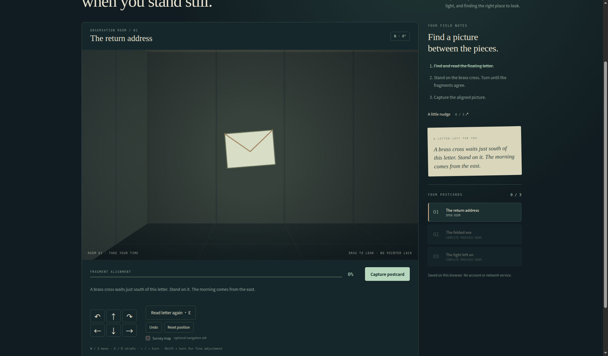
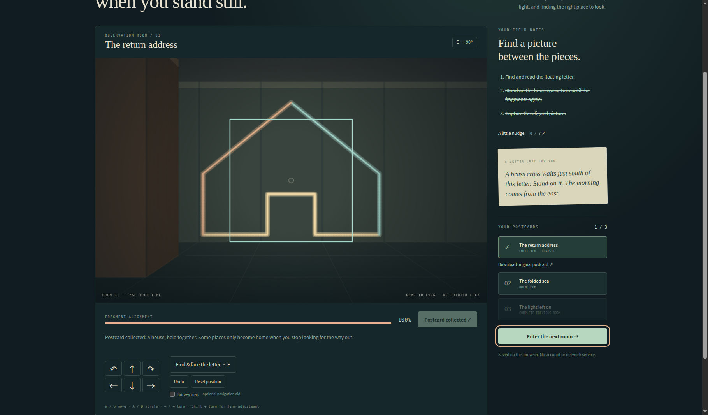
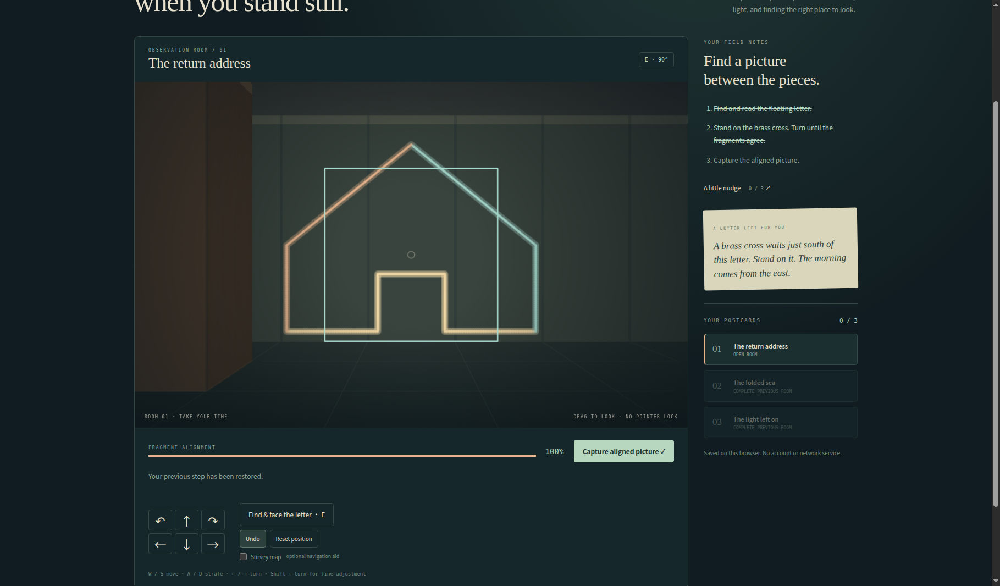
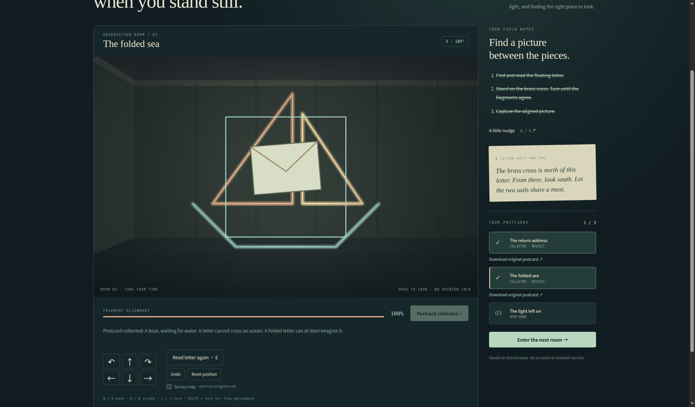
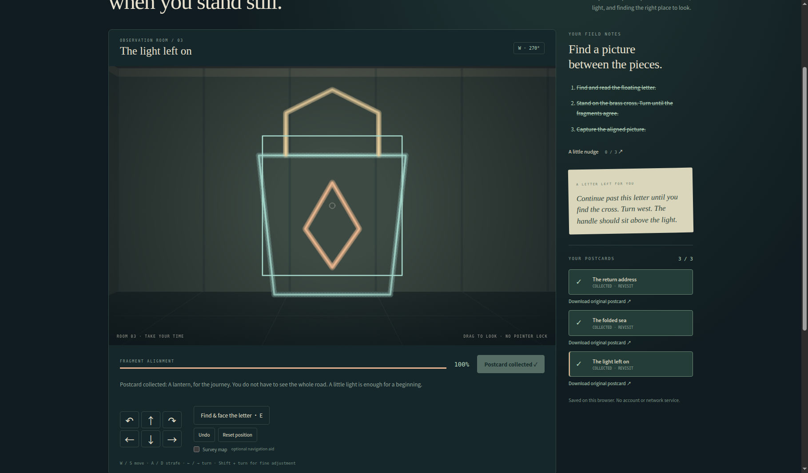
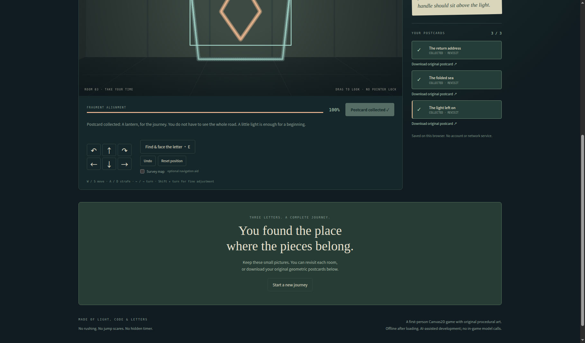

# Actual browser gameplay gallery — November 10, 2026

These are **eight actual desktop browser screenshots** from a complete manual playthrough of Parallax Postcards, using runtime source `3ede110d29eb248d307cfaf45e9783762032924c`. They show the original game interface, without browser chrome or personal information. Each PNG is copied byte-for-byte from its captured source; no crop, retouch, overlay or generated replacement has been applied.

The images are **1819 × 1066 pixels**. That is the image size, not a measured browser CSS viewport. They show selected page scroll positions, so an individual image does not claim to include the entire page. They are separate still screenshots, not continuous footage.

The coordinating operator read the letters, legally aligned and captured all three pictures, tested a rejected wrong-angle capture, undid the first capture from 1/3 to 0/3, recaptured it, reached the ending and reloaded to verify 3/3 restoration with Undo disabled. This run does not add mobile/narrow-viewport or touch-input coverage, and no console-error/console-clean claim is made.

## Captured steps

### Room 1 — read the letter

The return address shows its original letter text, with the read objective crossed out and 0/3 postcards. The player is facing north (0°).

### Wrong-angle capture is rejected

At 0% alignment and 0/3 postcards, the game explains that fragments are behind the player or hidden by a wall; no postcard is awarded.

### House captured — 1/3

The house fragments align at 100%, facing east (90°). The first postcard is marked collected, progress is 1/3, and the next room is open.

### Undo restores the uncaptured house — 0/3

After Undo, progress returns from 1/3 to 0/3. The aligned house remains visible at 100%, capture is available again, and the game says the previous step has been restored.

### Paper boat captured — 2/3

After recapturing the house and entering the second room, the paper boat is collected at 100% alignment, facing south (180°), with 2/3 postcards.

### Lantern captured — 3/3

The third room aligns a lantern at 100%, facing west (270°). All three postcard rows are marked collected and progress is 3/3.

### The ending is reached

The page is scrolled down to show the completed journey message and Start a new journey control, while the collection remains 3/3.

### Reload restores the completed journey

After reload, the game says the position and postcards have been restored. Progress remains 3/3, the ending remains visible and Undo is disabled; old undo history is not restored.

## Actual exported postcard

[Download the actual lantern SVG](actual-lantern-export.svg). The game download produced **998 bytes**, SHA-256 `b966a485c2b3e2d3274d1c08b3a9fc46f308b125363f0366b152b78057cd8e25`. It parses as an 800 × 560 SVG containing only original geometry/text, with no external references, scripts or event handlers. This is an actual downloaded application output, not a newly redrawn screenshot.

[Machine-readable evidence and per-file hashes](browser-evidence-20261110.json) record every screenshot size, dimension and SHA-256. This is observed browser evidence, not an authenticated competitive score or a full cross-browser test.

## Attribution and entry status

The game interface, letters and procedural geometry are original project work developed with Codex assistance and covered by the repository’s MIT license. No third-party artwork or provider marks were added. Existing cover illustrations remain cover illustrations; these new files are gameplay screenshots.

The itch.io jam is still **not joined or submitted**. Current action-time consent for the verification step remains pending; a saved gallery, GitHub repository or hosting preview does not join the jam or submit a game.
